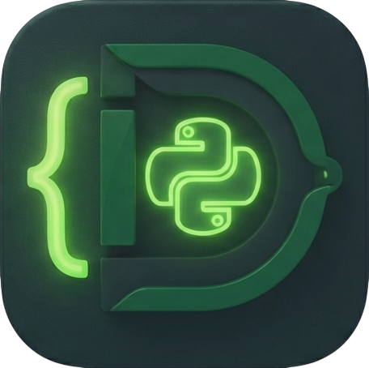

```markdown
# DjangoNAUT

> **Django Control Center** — a companion to your editor, not a replacement for your habits. Open it up to instantly see your model map, endpoint structure, live SQL queries, detect N+1 issues, and fix them with a single click.

A full-fledged Django development environment built on Electron: real-time SQL telemetry with N+1 detection and **auto-fixing**, 35+ project inspectors, an AI assistant, and an Enterprise audit panel with technical debt estimation. Plus the **`djangonaut audit` CLI** and a **GitHub Action** for static auditing in CI/CD pipelines.



## Quick Start (30 Seconds)

```bash
# 1. Static Audit — CLI scanner without GUI or background servers
npx djangonaut audit . --json          # or npm install -g djangonaut

# 2. Real-time SQL Telemetry (optional, inside your Django project)
pip install django-naut-agent
#   add "django_naut" to INSTALLED_APPS and run: python manage.py runserver_naut

# 3. Launch the Desktop Control Center
npm install && npm start               # or use the pre-built installer

```

In 5 seconds, you get: a complete map of models and endpoints, an integrated live terminal, every SQL query with its full call stack, and an N+1 detector with an **Auto-fix** button that inserts `select_related()` directly into the appropriate `views.py`.

## Security & Privacy

* **100% Local.** Both static analysis and runtime telemetry run strictly on your local machine. No project data is ever transmitted to external DjangoNAUT servers.
* **Loopback-Only Servers.** Built-in `terminal-server`, `log-server`, and `telemetry-server` bind strictly to `127.0.0.1` (see source code: `terminal-server.js:99`, `log-server.js:173`, `telemetry-server.js:28`). They are inaccessible from external networks.
* **Zero-Server CLI.** The `djangonaut audit` CLI is a pure static Node.js scanner that listens to no ports and transmits no data. Safe for isolated CI/CD pipelines.
* **Dependency Checks.** Dependency vulnerability lookups query PyPI/OSV APIs — these are the only external requests, triggered exclusively during manual audits (can be disabled via `--no-deps`).
* **AI Assistant.** Sends requests to AI providers (GROQ/OpenAI) **only** if you configure your own API key. Without a key, no requests leave your machine.
* **Open Source (MIT).** Anyone can audit the application codebase.

## Features

### Django Project Inspectors

| Panel | Functionality |
| --- | --- |
| **Django** | High-level project summary: installed apps, Django version, core settings |
| **URLs** | Complete route table with mapped view functions and jump-to-code navigation |
| **ORM Models** | Models, fields, relationships, methods, and built-in database record browser |
| **DB Explorer** | Active connections and database tables for selected DB instances |
| **Templates** | Template tree, inheritance map, and `block`/`extends` relationship structure |
| **Forms** | Form and ModelForm fields, widgets, and validation routines |
| **Static** | Static file tracking organized by application |
| **ASGI** | ASGI application inspection, routing configuration, and middleware chain |
| **Settings & Env** | Runtime configuration parser; accurately differentiates `DEBUG = True` from `.env` variables |
| **Commands** | Management commands list with help text, `requires_system_checks`, and `requires_migrations_checks` flags |
| **Middleware** | Request $\rightarrow$ Response pipeline order, execution hooks, and async detection |
| **i18n** | Health monitoring for `.po` catalogs, untranslated/fuzzy/obsolete strings, template usage, and missing keys |
| **Admin** | Registered `ModelAdmin` classes, options, inlines, and unregistered model detection |
| **DRF** | Routers, ViewSets, Serializers, permissions, and pagination. Includes **Send to API Client** for quick CRUD endpoint testing without Postman |
| **Migration Guard** | Visual migration graph, git branch conflict detection, auto-fix tools, and model drift checking (`makemigrations --check`) |

### Debugging & Performance

| Panel | Functionality |
| --- | --- |
| **Requests** | Real-time SQL telemetry per request: execution time, call stack, and **N+1 detection** with an **Auto-fix** button inserting `select_related()` / `prefetch_related()` into querysets |
| **Profiler** | Slow query identification and execution timing breakdowns |
| **Logs** | Centralized application log stream server |
| **Cache** | Cache backend status, active keys, TTL inspection, and purge actions |
| **Mail** | Interception of outgoing development emails captured as JSON payloads |
| **Bug Hunter** | Static bug analysis with safe auto-fixes: N+1 issues, unused imports, missing `on_delete`, exposed secrets, and `DEBUG` leaks |
| **Tests** | Integrated test runner and interactive test result viewer |
| **Security** | Vulnerability scanning: hardcoded secrets, SQL injection vectors, XSS, and CSRF flaws |
| **Deps** | Outdated or vulnerable dependency auditor using PyPI and OSV databases |
| **Tasks** | Celery task inspection, call tracking, and execution statuses |
| **Signals** | Signal receiver mapper, listener tracking, and side-effect detection |

### Project Audit

| Panel | Functionality |
| --- | --- |
| **Enterprise / Audit Report** | Comprehensive health score, upgrade complexity estimates (hours/days), dependency risk assessment, and report exports to Markdown, HTML, or PDF |

### Developer Tools

* **Terminal** — Embedded PTY shell directly inside the IDE
* **AI Assistant** — Codebase analysis, architectural planning, project memory, bug hunting, test generation, and mock data population
* **API Client** — Built-in HTTP client for API request testing
* **Docker** — Container and image management
* **Deploy** — Application deployment dashboard
* **Search** — Global codebase and project-wide search

## Installation & Setup

System Requirements: Node.js 18+, Python 3.9+.

```bash
git clone [https://github.com/Mardon-programm/Django_NAUT.git](https://github.com/Mardon-programm/Django_NAUT.git)
cd Django_NAUT
npm install
npm start

```

### Python Agent Setup

To enable real-time SQL telemetry, error interception, and interactive shell features, install the agent inside your Django environment:

```bash
pip install -e ./python-agent   # Installed from repository root

```

Add `"django_naut"` to `INSTALLED_APPS` in your `settings.py`, then run the development server via:

```bash
python manage.py runserver_naut --naut-port 9999

```

The middleware `django_naut.middleware.DjangoNautMiddleware` records every SQL query alongside its call stack and streams telemetry to the IDE. You can also add the middleware manually to `MIDDLEWARE` and define `DJANGONAUT_PORT` in `settings.py`.

## CLI: `djangonaut audit`

Run the exact same static analysis engines as the desktop IDE directly from your terminal — without a GUI or background servers. Ideal for local sanity checks and CI environments.

```bash
npm install -g djangonaut
djangonaut audit [folder] [options]

```

| Flag | Description |
| --- | --- |
| `--json` | Output complete audit report as structured JSON (`summary`, `issues`, `security`, `deps`, `report`) |
| `--fail-on=<level>` | Failure threshold: `critical`, `error` (default), `warning`, `performance`, `info`, `none` (never fail) |
| `--min-severity=<level>` | Display findings at or above the specified severity level (human-readable output) |
| `--no-deps` | Skip dependency checks (runs fully offline) |
| `--output=<path>` | Save JSON report to specified file path |
| `--markdown=<path>` | Save Markdown report to specified file path |
| `--help`, `--version` | Display help menu or version information |

Exit Codes: `0` — No issues found above the specified failure threshold, `1` — Issues found exceeding threshold, `2` — Fatal error (non-Django directory or invalid arguments).

## GitHub Action

A ready-to-use reusable workflow for auditing your Django repository on every code push. Include it in your GitHub repository:

```yaml
name: DjangoNAUT Audit
on: push
jobs:
  audit:
    uses: Mardon-programm/Django_NAUT/.github/workflows/djangonaut-audit.yml@main
    with:
      project-path: .
      fail-on: error

```

Parameters: `project-path`, `fail-on`, `min-severity`, `no-deps`, `node-version`, `json-report`, `markdown-report`, `cli-source`. Builds fail automatically if findings exceed the specified threshold, uploading JSON and Markdown audit reports as build artifacts.

## VS Code Migration Path

DjangoNAUT minimizes switching friction in four steps:

1. **Settings Import** — Settings $\rightarrow$ "Import from VS Code...": pulls your theme (*Dark+*, *Monokai*, *Dracula*, etc.), font configurations, tab size, word wrapping, minimap settings, and custom keybindings (`keybindings.json`) directly from VS Code user profiles or project `.vscode/` folders. Nothing changes without user confirmation.
2. **First-Run Onboarding** — A welcome screen introduces core capabilities on first launch. Opening a project automatically triggers a Bug Hunter scan with an actionable toast notification ("Found N issues").
3. **Companion Extension** (`vscode-extension/`) — Adds the "DjangoNAUT: Open Project" command to VS Code, launching DjangoNAUT targeting the current workspace (`--open <folder>`). Re-triggering focuses the existing window. Build via `npx @vscode/vsce package`.
4. **Editor Parity** — `Ctrl+D` (add selection to next match), multi-cursor editing, `Ctrl+/`, and `Alt+Up/Down` work natively as in VS Code. Includes **Emmet-lite** (`Ctrl+E`: expands `div#app>span*3` into markup), **Format on Save** (`black` $\rightarrow$ `autopep8` $\rightarrow$ `yapf`), and **Format Document** (`Shift+Alt+F`).

## Test Suite

```bash
npm test   # 65/65 PASS: syntax, Bug Hunter, CLI, migrations, N+1 (including auto-fix), python-agent, wiring, VS Code import, Emmet, formatting

```

## Build Targets

* **Linux / macOS** — See [BUILD.md](BUILD.md)
* **Windows**: `npm run build` (NSIS installer + portable binaries)

## License

MIT

```

```
